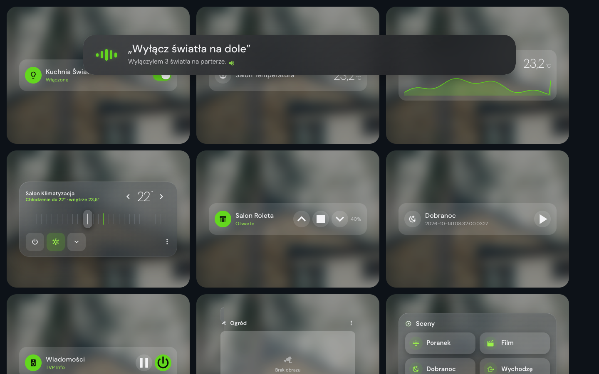
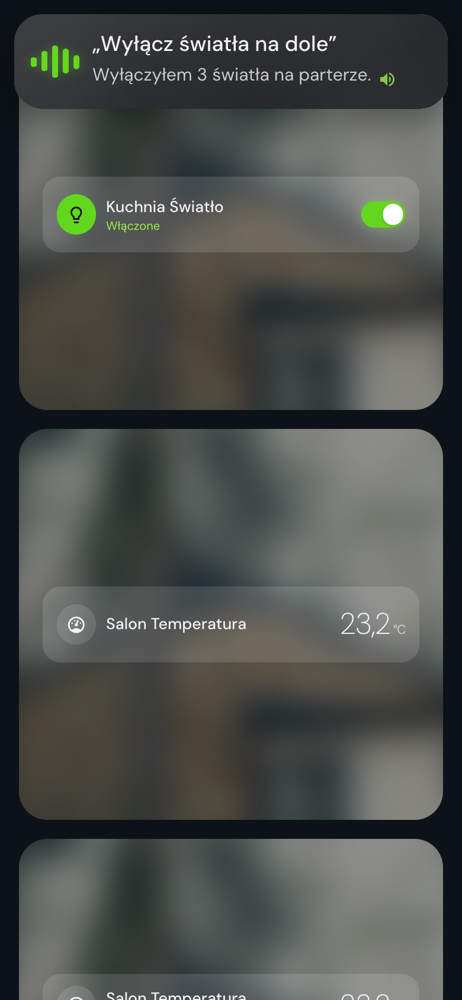

[English](../features.md) · [Polski](../pl/features.md) · **Français**

# Guide des fonctionnalités

Fonctionnement du tableau de bord partagé, du mode tablette murale, de la sauvegarde de la disposition et de l’assistant vocal. Retour au [README](../../README.fr.md).

## Tableau de bord partagé

Par défaut, tout le monde voit le même tableau de bord Nuvio : la disposition, l’apparence, les vues, les pièces et les réglages de la tablette murale configurés par un administrateur.

- **Qui modifie** : les administrateurs modifient le tableau de bord partagé (mode édition). Les autres personnes le voient sans le bouton de modification.
- **Disposition personnelle** : dans **Paramètres → Utilisateurs** (mode édition, administrateurs uniquement), chaque utilisateur Home Assistant a un interrupteur. Désactivez-le pour une personne et elle obtient sa propre disposition : celle-ci part d’une copie de la disposition partagée, le bouton de modification apparaît pour elle, et ses changements ne concernent qu’elle. Réactivez-le pour la ramener au tableau de bord partagé. Votre propre compte reste sur le tableau de bord partagé.
- **Qui voit une vue** : dans **Paramètres → Vues**, chaque vue (sauf Accueil) a un bouton des personnes. Chaque vue est visible par tout le monde par défaut ; désactivez une personne pour lui masquer la vue, y compris dans sa propre disposition. Son écran se recharge tout seul pour retirer la vue.
- **En direct** : les changements du tableau de bord partagé et de la liste arrivent sur les écrans ouverts sans rechargement.
- **Stockage** : la disposition partagée se trouve dans un tableau de bord de stockage masqué `nuvio-shared` (*Nuvio (disposition partagée)*, nommé dans la langue de l’administrateur qui l’a créé, administrateurs uniquement, absent de la barre latérale). Seuls les administrateurs peuvent l’écrire ; ne le modifiez pas à la main. Les dispositions personnelles restent dans les données utilisateur de Home Assistant (`frontend/set_user_data`, clé `nuvio_layout`), avec une copie locale par utilisateur. Les réglages d’Assist sont toujours personnels.
- **Mise à niveau depuis 1.3.x** : la première fois qu’un administrateur ouvre Nuvio 1.4.0, sa disposition actuelle devient le tableau de bord partagé. Jusque-là, chacun garde sa propre disposition comme avant.

## Mode tablette murale

Un écran de veille pour une tablette fixée au mur. Il est **désactivé par défaut** ; les administrateurs l’activent dans **Apparence → Mode tablette murale** (mode édition) et appuient sur **Terminé** pour enregistrer.

- **Démarrer après inactivité** : 30 s, 1, 2, 5, 10 ou 30 min sans toucher, souris ni clavier (2 min par défaut).
- **Assombrissement** : de 0 à 90 %, à quel point l’écran s’assombrit sous l’horloge (50 % par défaut).
- **Vue affichée au réveil** : *Dernière vue utilisée* (par défaut), *Accueil* ou n’importe quelle vue activée. Quand l’écran de veille s’active, le tableau de bord passe sur cette vue derrière lui : c’est elle que vous voyez en réveillant l’écran. Ni en mode édition ni pendant l’aperçu ; une vue verrouillée par PIN demande le code au réveil.
- **Photo** : votre fond d’écran du tableau de bord, un diaporama des fonds d’écran fournis (fondu enchaîné toutes les 45 s) ou l’URL de votre propre image (`https://…` ou `/local/…`).
- **Détecteur de mouvement** : choisissez n’importe quel `binary_sensor` ; les détecteurs de mouvement, d’occupation et de présence apparaissent en premier. Quand il passe à `on` pendant que l’écran de veille est affiché, l’écran se réveille. Sans capteur, seul le toucher le réveille.
- **Réveil** : toucher, appui sur une touche ou défilement. Le premier toucher réveille seulement l’écran et n’actionne pas la tuile située dessous.
- **Style de l’écran de veille** : *Horloge sur photo* (décrit plus bas) ou *Tableau* : un tableau clair ou sombre avec un grand jour de la semaine ou une grande horloge et la date, le lever et le coucher du soleil, un compte à rebours jusqu’au prochain événement sur la journée entière, la météo avec prévisions, les événements à venir, la lecture en cours, une photo et les températures des pièces. En mode Tableau, vous choisissez le thème (automatique selon le soleil, clair, sombre), le titre, les éléments affichés, l’ordre des cartes, l’entité météo ainsi que les calendriers et les pièces utilisés.
- Autres styles (2.16.0), chacun avec une tuile d’aperçu dans la galerie : *Horloge analogique* (cadran en verre dépoli sur la photo, trotteuse de la couleur d’accent, date, météo), *Horloge à palettes* (deux palettes pour les heures et les minutes), *Aurore boréale* (horloge fine sur une lumière qui ondule lentement dans la couleur d’accent) et *Nuit* (horloge chaude et tamisée sur fond noir pour les chambres et les écrans OLED, qui se déplace davantage chaque minute). La météo vient de l’entité météo choisie pour le Tableau, ou de la première disponible.
- **Aperçu de l’écran de veille** l’affiche immédiatement ; touchez pour le fermer.
- Disposition : une grande horloge au centre (sans panneau derrière), la date fixée en bas à gauche et, si Home Assistant a une entité `weather`, la météo actuelle (icône, température, condition) en haut à droite. L’horloge suit le format horaire de HA (12 / 24 h) et la langue, se déplace légèrement chaque minute pour protéger les dalles OLED, demande au navigateur de garder l’écran allumé pendant l’affichage (Screen Wake Lock) et respecte la réduction des animations.
- Il ne démarre que sur le tableau de bord Nuvio (pas en mode édition, pas dans un onglet en arrière-plan) et s’affiche au-dessus des boîtes de dialogue de Home Assistant.
- **Verrouillage par code PIN (BÊTA)** : activez *Verrouillage par code PIN*, définissez un code PIN de 4 à 8 chiffres et choisissez quand l’écran de veille se verrouille (immédiatement, après 1, 5, 15 ou 30 min). Un écran de veille verrouillé ne se réveille ni au toucher ni au mouvement : le toucher floute la photo et affiche un pavé numérique rond en verre avec les points du code PIN au-dessus et un bouton **Verrouiller** en dessous, qui ramène à l’écran de veille. Après 5 codes PIN erronés, le pavé attend 30 s (plus longtemps après d’autres tentatives), et il se ferme tout seul après 20 s sans toucher. **Verrouiller l’écran** dans le menu utilisateur verrouille tout de suite, et un rechargement de la page reste verrouillé. Seul un hachage du code PIN est stocké. Le verrouillage protège la tablette d’un usage occasionnel et ne remplace pas le mot de passe de Home Assistant.
- Les réglages font partie de la disposition : sur le tableau de bord partagé, ils s’appliquent à tout le monde, et une personne qui a sa propre disposition a ses propres réglages. Voir [Tableau de bord partagé](#tableau-de-bord-partagé).
- **Écran de veille sur cet appareil** (2.21.0) : les réglages sont partagés, mais le fonctionnement de l’écran de veille se choisit sur chaque appareil et n’est enregistré que dans ce navigateur. Activer l’écran de veille l’active sur l’appareil que vous utilisez ; sur un téléphone ou un ordinateur, désactivez **Écran de veille sur cet appareil** et la tablette murale le garde. Un appareil sans choix reste désactivé, sauf une tablette verrouillée par code PIN avant la mise à jour.
- **Verrouillage des vues par code PIN (BETA, 2.21.0)** : choisissez des vues (par exemple Caméras) qui demandent le code PIN avant d’afficher quoi que ce soit. Le code PIN est celui du *Verrouillage par code PIN*, à définir d’abord. Après le bon code, la vue reste ouverte 5 minutes dans cet onglet du navigateur, ou jusqu’au démarrage de l’écran de veille ou à l’utilisation de **Verrouiller l’écran** : toutes les vues déverrouillées se referment alors et la vue affichée redemande le code PIN au réveil ; **Retour** ramène à la vue précédente. C’est un verrou de confort contre l’usage accidentel, pas une sécurité : toute personne ayant un compte Home Assistant peut voir les mêmes données dans un autre tableau de bord.

## Style du tableau de bord

**Paramètres > Apparence > Style du tableau de bord** (2.16.0) propose huit styles prêts à l’emploi, chacun présenté par une petite miniature du tableau de bord : Nuvio (par défaut), Givre, Minuit, Crépuscule, Forêt, Océan, Pastel et Graphite. Un style définit l’accent, le fond d’écran, l’assombrissement et le verre (teinte des cartes, des tuiles et du panneau, intensité du flou et, pour Pastel et Graphite, le rayon des coins). L’accent et le fond d’écran peuvent être changés ensuite. Avec *Flou du verre* désactivé, le remplissage dense et lisible est conservé. Le choix est enregistré avec la disposition (`app.look`) et fait donc partie de la sauvegarde.

**Réglages > Apparence > Fond du panneau** (2.21.0) désactive le panneau de verre commun derrière les cartes. Désactivé, les cartes reposent directement sur le fond d’écran, chacune avec son propre verre, sans cadre commun (comme `panel_backdrop: false` dans la configuration de la page). **Cette vue** remplace le choix pour la vue affichée : *Comme partout*, activé ou désactivé.

## Performances

Les tablettes anciennes vident vite leur batterie quand chaque surface en verre est floutée et que les animations décoratives tournent en continu. **Paramètres > Apparence > Performances** propose deux options, enregistrées uniquement sur cet appareil, pour qu’une tablette murale et un ordinateur puissent différer :

- **Flou du verre** : *Complet* (par défaut sur ordinateur), *Léger* (par défaut sur écran tactile : flou plus faible, sans ombres lourdes), *Désactivé* (aucun flou ; le verre reçoit un remplissage plus dense et les boîtes de dialogue sont opaques). *Auto* choisit l’une de ces valeurs et indique laquelle.
- **Économie d’énergie** : arrête les animations en boucle (zoom de la photo de l’écran de veille, ventilateurs qui tournent, anneaux qui pulsent, tambour du lave-linge, etc.) et actualise les instantanés des caméras au plus toutes les 30 s. *Auto* l’active sur les iPad et iPhone sous iOS ou iPadOS antérieur à 18 et sur le matériel très faible ; le flou sur *Auto* est alors désactivé lui aussi.

Indépendamment de ces options, les animations des cartes qui sortent de l’écran se mettent en pause, et *Réduire la transparence* dans les réglages du système désactive le flou en mode *Auto*.

## Sauvegarde de la disposition

Les administrateurs peuvent exporter et importer toute la disposition de Nuvio depuis **Apparence → Sauvegarde de la disposition** (mode édition).

- **Exporter** télécharge `nuvio-uklad-YYYY-MM-DD.json` ; **Copier dans le presse-papiers** copie le même JSON. Choisissez ce qui est inclus : vues et vues personnalisées ; disposition, widgets avec leurs entités, titres, largeurs des sections et éléments masqués ; apparence (accent, fond d’écran, assombrissement) ; largeurs du panneau des vues ; réglages du mode tablette murale.
- **Importer** accepte un fichier (sélecteur ou glisser-déposer) ou du JSON collé. Le fichier est validé et un résumé indique le nombre de vues, de widgets, de sections et d’entités, en signalant les entités absentes de cette instance. Choisissez les parties à importer, puis **Remplacer** ou **Fusionner**.
- Avant l’import, la disposition actuelle est conservée comme sauvegarde ; **Restaurer la précédente** dans la notification (ou dans la section Sauvegarde de la disposition) annule l’import en un clic.
- Le fichier est versionné (`format`, `schema`, `nuvio`, `exported`). Les anciennes données de disposition brutes sont converties automatiquement ; les fichiers d’un schéma plus récent ou endommagés sont refusés avec un message clair.

## Assistant vocal

Parlez à l’assistant Home Assistant (Assist) sans quitter le tableau de bord. Ouvrez-le avec le bouton micro de l’en-tête ou la touche **A** quand vous n’écrivez pas dans un champ.

  
  

- **Barre vocale** (par défaut) : une barre en verre descend en haut de l’écran et écoute aussitôt. Des barres vertes suivent votre voix, puis la barre affiche entre guillemets ce qu’elle a entendu et la réponse en dessous. Avec **Lire les réponses à voix haute**, la réponse est prononcée.
- **Se masque seule** : 2 secondes après une réponse lue, sinon après le temps de la lire (2,5 à 8 secondes), aussi après une erreur. Échap ou un clic à côté de la barre la ferme plus tôt. Touchez les barres pour arrêter l’écoute, interrompre la lecture ou parler à nouveau.
- **Reconnaissance vocale** : le son est envoyé au moteur de reconnaissance vocale de l’assistant (par exemple Whisper ou Home Assistant Cloud), comme dans l’application Home Assistant. Il faut Home Assistant ouvert en HTTPS (ou `localhost`) et un assistant avec un moteur de reconnaissance vocale. Sinon Nuvio utilise la reconnaissance vocale du navigateur (Chrome, Edge, Safari) et, à défaut, ouvre un champ de texte.
- **Questions de suivi** : quand l’assistant pose une question (par exemple « Dans quelle pièce ? »), la barre écoute à nouveau dans la même conversation.
- **En cas de problème** : pas d’accès au micro, pas de micro, micro utilisé par une autre application ou rien entendu affichent un court message, et un champ de texte s’ouvre quand c’est utile. Quand la page passe en arrière-plan (autre onglet, téléphone verrouillé), la barre se ferme et coupe le micro.
- **Réglages** : **Paramètres > Système > Assist**, enregistrés pour l’utilisateur Home Assistant : bouton dans l’en-tête, raccourci clavier A, assistant par défaut, **Apparence** (*Barre vocale* ou *Fenêtre de discussion*, l’ancienne fenêtre avec des bulles), **Écouter à l’ouverture**, **Conversation continue**, **Lire les réponses à voix haute** (activé par défaut dans la barre vocale), micro et suggestions (fenêtre de discussion).
- Les réglages des versions précédentes restent valables : sans apparence enregistrée, c’est la barre vocale, et **Lire les réponses à voix haute** garde sa valeur enregistrée.

## Nuvio TV

**Paramètres > Système > TV** associe l’application Nuvio TV sans saisir de jeton. La page est marquée Bêta. Elle fait partie du panneau de réglages : les administrateurs et les utilisateurs qui ont leur propre disposition la voient.

- Saisissez l’adresse de la TV (`10.0.8.117:8798`) et le code à 6 chiffres affiché sur la TV, ou collez dans le champ d’adresse le lien de son code QR. L’adresse de Home Assistant est préremplie avec l’adresse actuelle et peut être modifiée.
- **Associer** crée un jeton d’accès de longue durée nommé *Nuvio TV date heure* et l’envoie avec l’adresse à la TV via votre réseau domestique. Quand Home Assistant est ouvert en `http://` (cas typique sur un réseau domestique), Nuvio envoie les données directement à la TV par une requête en arrière-plan, sans nouvel onglet : la TV répond *accepté*, *mauvais code* (vérifiez le code sur la TV), *trop de tentatives* (attendez et utilisez le nouveau code affiché sur la TV) ou *refusé*, et dans les trois derniers cas le jeton qui vient d’être créé est supprimé. Si l’application TV est plus ancienne et n’autorise pas cette requête, ou si la TV est injoignable en 8 secondes, le résultat est inconnu, donc Nuvio continue d’attendre la TV comme avant. Quand Home Assistant est ouvert en `https://`, les données partent dans un formulaire qui s’ouvre dans un onglet que Nuvio ouvre au moment du clic (cela évite le blocage par les navigateurs, et l’onglet se ferme seul dès que la TV est connectée ; en cas de délai dépassé, il reste ouvert pour que vous puissiez lire le message de la TV). Si votre navigateur bloque quand même l’onglet, le jeton est créé et un second bouton **Ouvrir la page de la TV et envoyer** apparaît : appuyez dessus dans les 2 minutes, passé ce délai le jeton non envoyé est supprimé. Seules les adresses de votre réseau domestique sont acceptées : 10.x, 172.16 à 31.x, 192.168.x, 169.254.x et `.local`. Les données traversent le réseau sans chiffrement.
- La TV confirme en écrivant un marqueur (`nuvio_tv_seen`) dans les données de votre utilisateur Home Assistant. Nuvio le vérifie chaque seconde pendant 60 secondes au plus (120 secondes seulement quand l’adresse Home Assistant envoyée commence par `http://` et que son hôte n’est pas sur votre réseau domestique, car la TV vous demande alors d’abord de confirmer une connexion non chiffrée avec la télécommande), puis affiche *TV connectée* ou supprime le jeton inutilisé. L’application TV ignore cette question pour un Home Assistant en `http://` sur votre réseau domestique et écrit le marqueur juste après sa connexion.
- La liste affiche vos jetons Nuvio TV avec la date d’ajout et l’heure de la dernière connexion de la TV. **Supprimer** efface le jeton, et la TV revient à son écran d’association.
